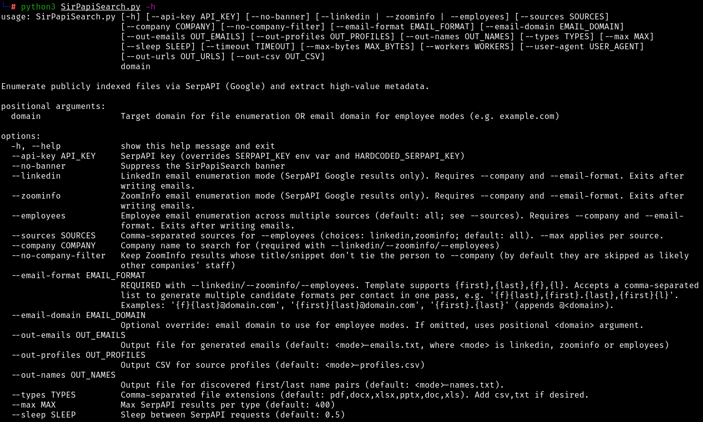
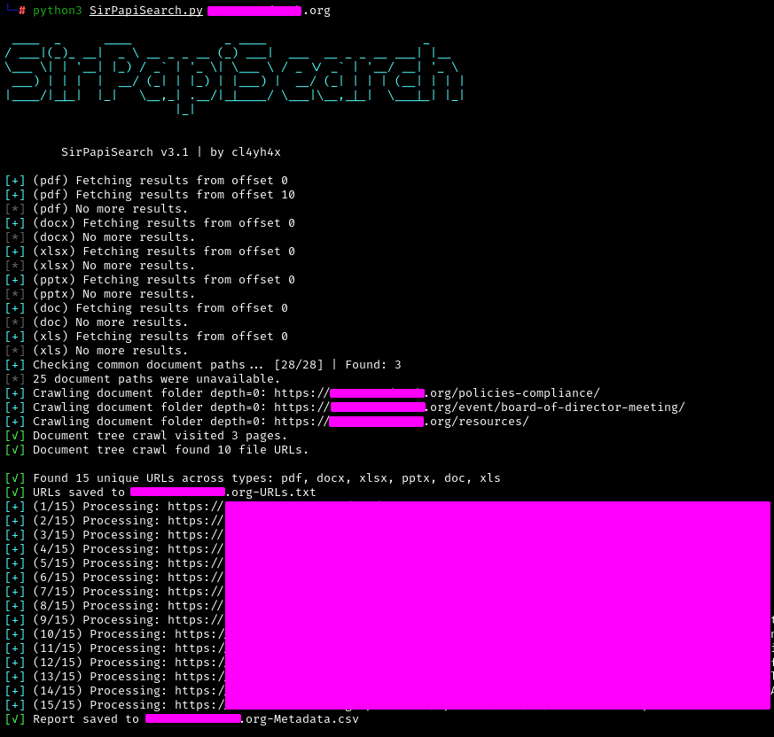
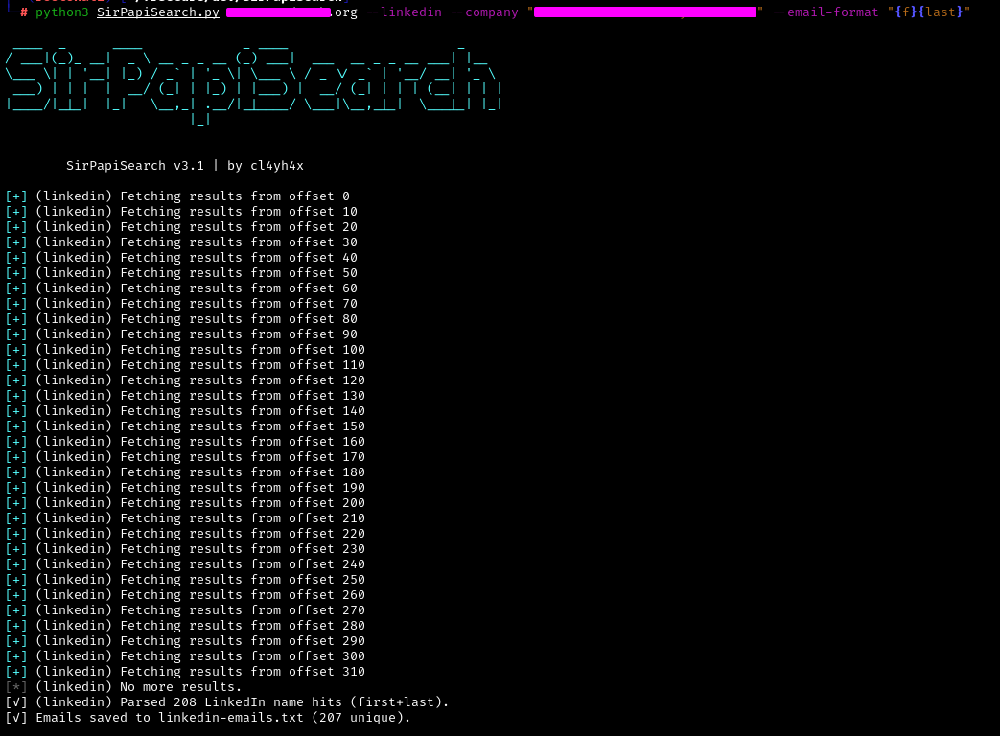

## Overview

SirPapiSearch is a SerpAPI-powered OSINT tool designed to automate:

- Public file enumeration from Google indexing and document portals
- Recursive discovery of multi-level CMS-backed document repositories
- Document metadata extraction without permanently saving files to disk
- Employee name discovery (LinkedIn and ZoomInfo) and email pattern generation

Built specifically for **penetration testing and OSINT workflows**.

<p align="center">
  
</p>

---

## Features

### File Enumeration (Default Mode)

- Searches Google via SerpAPI using domain-based dorks
- Supports file types:
  - `pdf`, `docx`, `xlsx`, `pptx`, `doc`, `xls`, `txt`, `csv`
- Discovers common document repositories
- Recursively traverses multi-level document folders
- Extracts document links from HTML and embedded JSON routes
- Detects files hosted on common CMS/CDN platforms
- Extracts:
  - Author, Title, Creator, Producer
  - Application, Company, LastModifiedBy
  - Creation/Modification timestamps
  - Internal path indicators
  - File hashes (SHA256)
  - High-signal findings (emails, usernames, keywords)
- Streamed downloads (no disk writes)
- Concurrent document-path probing and file downloads/extraction via a thread pool (`--workers`, default 10)
- Outputs file URLs to `domain-URLs.txt` and extracted metadata to `domain-Metadata.csv` by default

<p align="center">
  
</p>

---

### LinkedIn Email Enumeration Mode

- Uses Google-indexed LinkedIn results (no scraping)
- Extracts **FirstName + LastName**
- Generates email formats
- Accepts multiple comma-separated formats in a single run to try several candidate conventions at once (e.g. unsure whether the target uses `flast` or `first.last`)

Supported placeholders:
- `{first}`, `{last}`, `{f}`, `{l}`

<p align="center">
  
</p>

---

### ZoomInfo & Multi-Source Employee Enumeration

- Uses Google-indexed ZoomInfo person pages (`zoominfo.com/p/`, no scraping)
- ZoomInfo-specific parsing of result titles (e.g. `John Doe - Director of IT - Company | ZoomInfo`, `John Doe Email & Phone Number | ...`) with a fallback to the profile URL slug
- `--zoominfo` runs ZoomInfo only; `--employees` runs every source (LinkedIn + ZoomInfo) and merges the results
- `--employees --sources linkedin` or `--sources zoominfo` picks specific sources
- ZoomInfo names are cross-checked against the profile URL (`/p/First-Last/...`), which is always the person's name, so unusual title formats can't produce bad names
- ZoomInfo results are kept only when they tie the person to `--company` as a current or former employee: the title names it, or the snippet lists it in the person's job history or prose (e.g. "role at Company"). Mentions in ZoomInfo's "similar people" sidebar don't count. Use `--no-company-filter` to keep every result
- Names are de-duplicated across sources before email generation; the profiles CSV records which source found each person, plus the Google snippet
- `--max` applies per source, so `--employees` uses roughly twice the SerpAPI queries of a single source

---

## Installation

```bash
git clone https://github.com/clayhax/SirPapiSearch.git
cd SirPapiSearch
python3 -m pip install -r requirements.txt
```
## API Key Configuration
* Register and grab your SerpAPI key https://serpapi.com/
* SirPapiSearch supports three methods (priority order):

  - `--api-key`
  - `SERPAPI_KEY` environment variable 
  - Hardcoded fallback in script

---

### Usage

## File Enumeration (Default)

```bash
python3 SirPapiSearch.py example.com
```

Tune concurrency for document-path probing and file downloads with `--workers` (default: 10):

```bash
python3 SirPapiSearch.py example.com --workers 20
```

## LinkedIn Mode

```bash
python3 SirPapiSearch.py company.com --linkedin --company "Company Name" --email-format "{f}{last}"
```

Not sure which convention the company uses? Pass several comma-separated formats in one run — every contact gets rendered against each format, with no extra SerpAPI queries:

```bash
python3 SirPapiSearch.py company.com --linkedin --company "Company Name" --email-format "{f}{last},{first}.{last},{first}{l},{last}{f},{last}.{first}"
```

## ZoomInfo Mode

```bash
python3 SirPapiSearch.py company.com --zoominfo --company "Company Name" --email-format "{f}{last}"
```

## Employee Mode (all sources)

```bash
python3 SirPapiSearch.py company.com --employees --company "Company Name" --email-format "{f}{last}"
```

Limit to specific sources with `--sources`:

```bash
python3 SirPapiSearch.py company.com --employees --sources zoominfo --company "Company Name" --email-format "{f}{last}"
```

Each mode writes `<mode>-emails.txt`, `<mode>-names.txt` and `<mode>-profiles.csv` (where `<mode>` is `linkedin`, `zoominfo` or `employees`). Override them with `--out-emails`, `--out-names` and `--out-profiles`.

---

## ⚠ Disclaimer

This tool is intended for **authorized security testing only**.

## 👤 Author

clayhax

---

Comments, suggestions, and improvements are always welcome. Be sure to follow @0xclayhax on Twitter for the latest updates.
